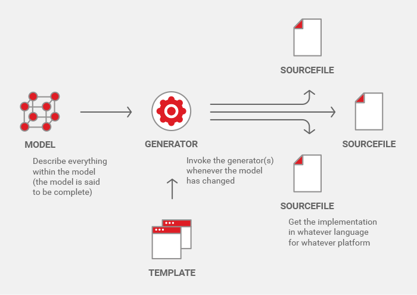
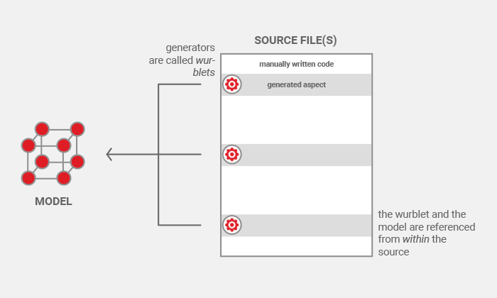
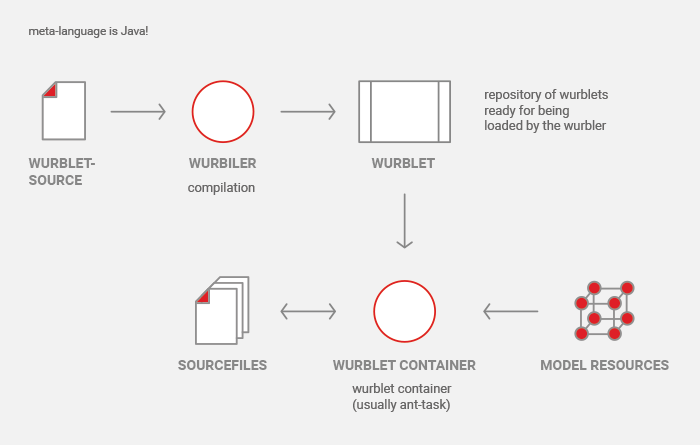

# Code Levels

While typical code generators work with code at two levels (generator level
and generated code level), the Wurbelizer operates at three levels:

1. **wurblet level**: holds the code for the generator itself
2. **output level**: the generated code
3. **source level**: the application's source code.

A traditional, template-based generator works from the model *towards* the code:
it owns whole source files and must know their names, structure and relationships.

The Wurbelizer inverts this perspective — from the code *towards* the model. Small
generators, called *wurblets*, are embedded within the source files; the wurblet and
the model are referenced from within the source itself, so the generator only needs to
know how to produce a single *aspect* of the code.

The source code of the wurblet itself contains a mix of the first two levels.
The third level is parsed and modified by the wurbler. 
The wurbler analyzes the source files and locates comment-, Java- and generated code sections. 
The comments, which are ignored by the Java compiler, are parsed
for wurblet anchors, variables and so-called here-documents. 
Then the wurblets are applied and the generated code inserted or replaced within
the guarded blocks of the source file.
The wurbler repeats these steps until there is no more change (generated code could
contain new wurblet anchors!) and finally writes back the
source file to the filesystem (if there was any change at all).

The overall pipeline — the meta-language being plain Java — looks like this: the
*wurbiler* compiles the wurblet sources into wurblets, which are loaded into a wurblet
container and, together with the model resources, drive the generation back into the
source files.

## Further reading

- [Source Level Syntax](source-syntax.md) — what the wurbler parses at the source level
- [Wurblet Level Syntax](wurblet-syntax.md) — mixing the wurblet and output levels

---

**Navigation:** [← Previous: Quickstart](quickstart.md) | [Contents](toc.md) · [Index](index.md) | [Next: Build Tool Integration →](integration.md)
