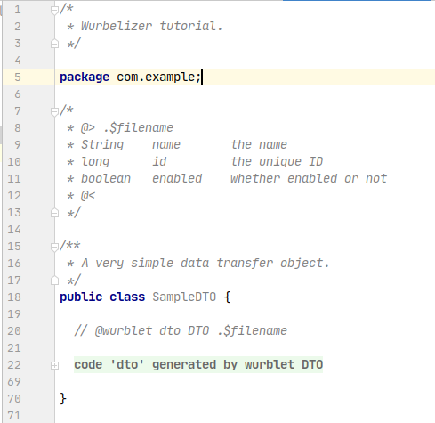

# Quickstart


This 5-minute tutorial gives a first impression of agile generative programming with
the Wurbelizer. You will build a small wurblet that generates the code for a *data
transfer object* (DTO) and let the wurbler weave it into a hand-written source file.

The complete, runnable sources are available at
[github.com/harrharr/wurbelizer-tutorial](https://github.com/harrharr/wurbelizer-tutorial).

> The tutorial is written against `wurbelizer.version` `25.7.0.0` (JDK 25, Maven >= 3.9.10).
> The runnable reference sources on GitHub still pin older versions; the steps are
> identical — just the version numbers below differ.

## Prerequisites

- JDK 25+ and Maven 3.9.10+ on your `PATH`. Check with `mvn --version`.
- Any modern Java IDE or plain command-line tools. (Eclipse cannot fold the generated
  blocks, but everything else works.)

The project is a multi-module Maven build with two modules: one that *creates* the
wurblet, and one that *uses* it to generate code.

### Parent `pom.xml`

```xml
<project ...>
  <modelVersion>4.0.0</modelVersion>

  <groupId>com.example</groupId>
  <artifactId>wurbelizer-tutorial</artifactId>
  <version>1.0-SNAPSHOT</version>
  <packaging>pom</packaging>

  <properties>
    <project.build.sourceEncoding>UTF-8</project.build.sourceEncoding>
    <project.build.resourceEncoding>UTF-8</project.build.resourceEncoding>
    <wurbelizer.version>25.7.0.0</wurbelizer.version>
  </properties>

  <modules>
    <module>wurblets</module>
    <module>sample</module>
  </modules>

  <build>
    <pluginManagement>
      <plugins>
        <plugin>
          <groupId>org.wurbelizer</groupId>
          <artifactId>wurbelizer-maven-plugin</artifactId>
          <version>${wurbelizer.version}</version>
        </plugin>
        <plugin>
          <groupId>org.apache.maven.plugins</groupId>
          <artifactId>maven-compiler-plugin</artifactId>
          <version>3.13.0</version>
          <configuration>
            <release>25</release>
          </configuration>
        </plugin>
      </plugins>
    </pluginManagement>
  </build>
</project>
```

## 1. The first wurblet

The `wurblets` module holds the generator. Its `pom.xml` depends on the Wurbelizer and
runs the `wurbile` goal, which translates the wurblet source code into compilable Java
plus a resource file holding the fixed strings:

```xml
<project ...>
  <parent>
    <groupId>com.example</groupId>
    <artifactId>wurbelizer-tutorial</artifactId>
    <version>1.0-SNAPSHOT</version>
  </parent>

  <artifactId>wurblets</artifactId>

  <dependencies>
    <dependency>
      <groupId>org.wurbelizer</groupId>
      <artifactId>wurbelizer</artifactId>
      <version>${wurbelizer.version}</version>
    </dependency>
  </dependencies>

  <build>
    <plugins>
      <plugin>
        <groupId>org.wurbelizer</groupId>
        <artifactId>wurbelizer-maven-plugin</artifactId>
        <executions>
          <execution>
            <goals>
              <goal>wurbile</goal>
            </goals>
          </execution>
        </executions>
      </plugin>
    </plugins>
  </build>
</project>
```

### The model

The DTO model is a simple line-based format. Each non-empty, non-`#` line describes one
property as `<java-type> <name> [comment...]`:

```
String    name       the name
long      id         the unique ID
boolean   enabled    whether enabled or not
```

### The wurblet base class

The logic that *parses* the model is plain Java. A wurblet is any class implementing
`org.wurbelizer.wurblet.Wurblet`; the abstract base classes `AbstractWurblet` and
`AbstractJavaWurblet` make this easy. Put `DTOWurblet.java` in
`wurblets/src/main/java/com/example/wurblets/`:

```java
package com.example.wurblets;

import org.wurbelizer.wurbel.WurbelException;
import org.wurbelizer.wurbel.WurbelHelper;
import org.wurbelizer.wurblet.AbstractJavaWurblet;

import java.io.BufferedReader;
import java.io.IOException;
import java.util.ArrayList;
import java.util.List;
import java.util.StringTokenizer;

/**
 * Base class for the {@code @DTO}-wurblet.
 * <p>
 * Parses wurblet args and the model.
 */
public class DTOWurblet extends AbstractJavaWurblet {

  /** DTO property. */
  protected class Property {

    private final String type;        // the java type
    private final String name;        // the property name
    private final String comment;     // the comment

    public Property(String type, String name, String comment) {
      this.type = type;
      this.name = name;
      this.comment = comment == null || comment.isEmpty() ? "the " + name + " property" : comment.trim();
    }

    public String getType()       { return type; }
    public String getName()       { return name; }
    public String getComment()    { return comment; }
    public String getGetterName() { return ("boolean".equals(type) ? "is" : "get") + firstToUpper(name); }
    public String getSetterName() { return "set" + firstToUpper(name); }
  }

  protected String filename;            // here-doc holding the model (given as "@> .$filename")
  protected List<Property> properties;  // the DTO properties

  @Override
  public void run() throws WurbelException {
    super.run();

    if (getContainer().getArgs().length == 0) {
      throw new WurbelException("usage: @wurblet <guardname> DTO <filename>");
    }
    filename = getContainer().getArgs()[0];

    properties = new ArrayList<>();

    try (BufferedReader reader = new BufferedReader(WurbelHelper.openReader(filename))) {
      String line;
      while ((line = reader.readLine()) != null) {
        line = line.trim();
        if (!line.isEmpty() && !line.startsWith("#")) {
          StringTokenizer stok = new StringTokenizer(line);
          String type = null;
          String name = null;
          StringBuilder comment = new StringBuilder();
          while (stok.hasMoreTokens()) {
            String token = stok.nextToken();
            if (type == null)      { type = token; }
            else if (name == null) { name = token; }
            else {
              if (comment.length() > 0) { comment.append(' '); }
              comment.append(token);
            }
          }
          if (type == null || name == null) {
            throw new WurbelException("property line too short: '" + line + "'");
          }
          properties.add(new Property(type, name, comment.toString()));
        }
      }
    }
    catch (IOException ex) {
      throw new WurbelException("reading model " + filename + " failed", ex);
    }
  }

  private String firstToUpper(String str) {
    return str.substring(0, 1).toUpperCase() + str.substring(1);
  }
}
```

### The template

The `.wrbl` file is where output text and Java logic meet. Recall the level-switching
markers: `@[ … ]@` switches to the wurblet (Java) level, and `@( … )@` embeds a
wurblet-level expression back into the output. Put `DTO.wrbl` in
`wurblets/src/main/wurblets/com/example/wurblets/`:

```
@{package com.example.wurblets}@
@{import java.util.*}@
@{import java.io.*}@
@{import org.wurbelizer.wurbel.*}@
@{import org.wurbelizer.wurblet.*}@
@{import org.wurbelizer.misc.*}@
@{extends DTOWurblet}@
@{args}@
@[
  private void wurbel() throws WurbelException {

    // create declarations
    for (Property property: properties) {
]@
  private final @(property.getType())@ @(property.getName())@;  // @(property.getComment())@
@[
    }
]@

  /**
   * Creates a @(getClassName())@.
   *
@[
    // create constructor
    StringBuilder args = new StringBuilder();
    for (Property property: properties) {
      if (args.length() > 0) {
        args.append(", ");
      }
      args.append(property.getType()).append(' ').append(property.getName());
]@
   * \@param @(property.getName())@ @(property.getComment())@
@[
    }
]@
   */
  public @(getClassName())@(@(args)@) {
@[
    for (Property property: properties) {
]@
    this.@(property.getName())@ = @(property.getName())@;
@[
    }
]@
  }
@[
    // create getter
    for (Property property: properties) {
]@

  /**
   * Gets @(property.getComment())@.
   *
   * \@return @(property.getComment())@
   */
  public @(property.getType())@ @(property.getGetterName())@() {
    return @(property.getName())@;
  }
@[
    }
  }
]@
```

Running `mvn clean install` in the parent directory now invokes the wurbiler (the
wurblet compiler), compiles the generated Java, and packages the `wurblets` jar.

## 2. Generate code

The `sample` module *uses* the wurblet. Its `pom.xml` runs the `wurbel` goal, loads the
wurblets from the `wurblets` artifact built above, and prepends the package
`com.example.wurblets` so a simple wurblet name like `DTO` resolves:

```xml
<project ...>
  <parent>
    <groupId>com.example</groupId>
    <artifactId>wurbelizer-tutorial</artifactId>
    <version>1.0-SNAPSHOT</version>
  </parent>

  <artifactId>sample</artifactId>

  <build>
    <plugins>
      <plugin>
        <groupId>org.wurbelizer</groupId>
        <artifactId>wurbelizer-maven-plugin</artifactId>
        <executions>
          <execution>
            <goals>
              <goal>wurbel</goal>
            </goals>
          </execution>
        </executions>
        <configuration>
          <wurbletDependencies>
            <wurbletDependency>
              <groupId>${project.groupId}</groupId>
              <artifactId>wurblets</artifactId>
              <version>${project.version}</version>
            </wurbletDependency>
          </wurbletDependencies>
          <wurbletPaths>
            <wurbletPath>com.example.wurblets</wurbletPath>
          </wurbletPaths>
        </configuration>
      </plugin>
    </plugins>
  </build>
</project>
```

### The source file

Create `SampleDTO.java` in `sample/src/main/java/com/example/`. It carries the model as
a *here-document* in a leading comment (`@> … @<`) and a *wurblet anchor* marking where
the generated code belongs:

```java
package com.example;

/*
 * @> .$filename
 * String    name       the name
 * long      id         the unique ID
 * boolean   enabled    whether enabled or not
 * @<
 */

/**
 * A very simple data transfer object.
 */
public class SampleDTO {

  // @wurblet dto DTO .$filename

}
```

### Run it

Run `mvn clean install` again. The wurbler reads the anchor, runs the `DTO` wurblet
against the `.$filename` model, and writes the generated code straight into a guarded
block in `SampleDTO.java`:

```java
public class SampleDTO {

  // @wurblet dto DTO .$filename

  //<editor-fold desc="code 'dto' generated by wurblet DTO">//GEN-BEGIN:dto

  private final String name;  // the name
  private final long id;  // the unique ID
  private final boolean enabled;  // whether enabled or not

  /**
   * Creates a SampleDTO.
   *
   * @param name the name
   * @param id the unique ID
   * @param enabled whether enabled or not
   */
  public SampleDTO(String name, long id, boolean enabled) {
    this.name = name;
    this.id = id;
    this.enabled = enabled;
  }

  /**
   * Gets the name.
   *
   * @return the name
   */
  public String getName() {
    return name;
  }

  /**
   * Gets the unique ID.
   *
   * @return the unique ID
   */
  public long getId() {
    return id;
  }

  /**
   * Gets whether enabled or not.
   *
   * @return whether enabled or not
   */
  public boolean isEnabled() {
    return enabled;
  }

  //</editor-fold>//GEN-END:dto

}
```

Take a look at the file in your IDE and see what happened:



In the IDE the block appears collapsed. You can expand it, but you should not edit
inside it: the region belongs to the wurblet and **manual changes are overwritten on the
next build**. Change the model and re-run — the generated code follows.

## Further reading

- [Code Levels](./code-levels.md)
- [Build Tool Integration](./integration.md)
- [Wurblet Level Syntax](./wurblet-syntax.md)
- [Source Level Syntax](./source-syntax.md)
- [Writing Wurblets](./writing-wurblets.md)

---

**Navigation:** [← README](../../README.md) | [Contents](toc.md) · [Index](index.md) | [Next: Code Levels →](code-levels.md)
